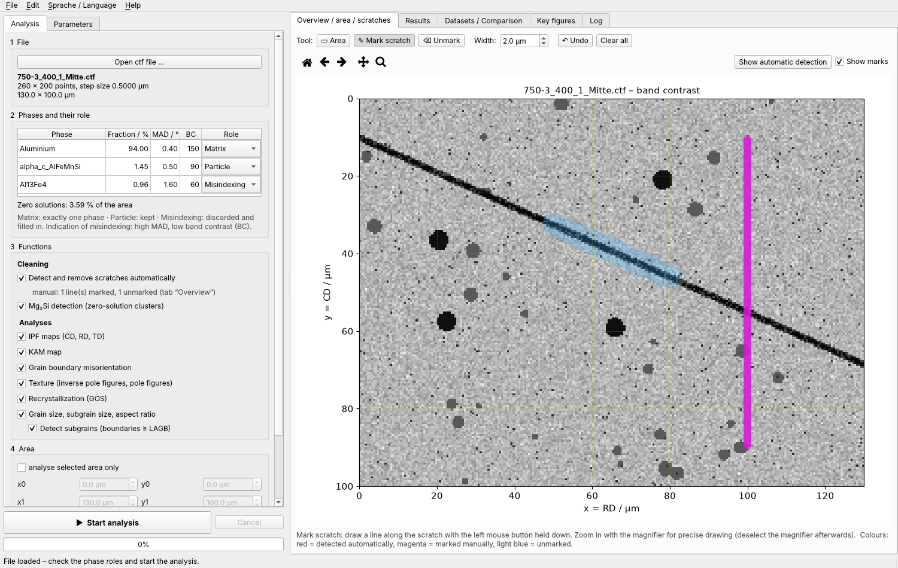
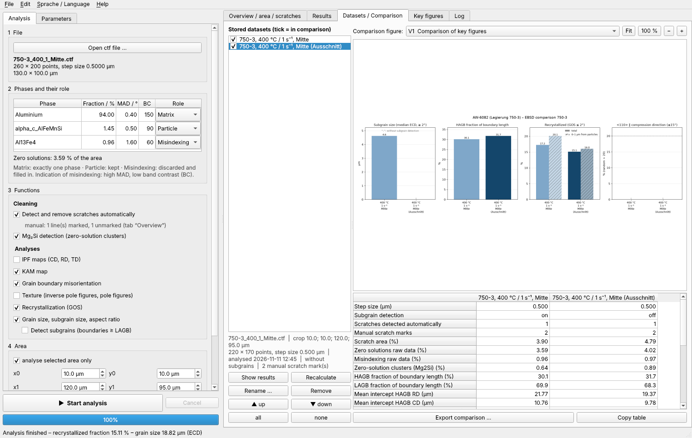

# EBSD Analysis (EBSD-Auswertung) – IMF, TU Bergakademie Freiberg

Windows GUI program for the analysis of EBSD maps (Oxford Instruments / AZtec `.ctf` files) of aluminium alloys,
based on [MTEX for Python](https://github.com/mtex-toolbox/pymtex). It turns a raw map into a reproducible set of
figures, key figures and grain lists in a few minutes, without writing code.

Developed at the Institute of Metal Forming (IMF), TU Bergakademie Freiberg, for hot-deformed and forged
AW-6082 and related Al–Mg–Si alloys. It works for any map with one cubic matrix phase.

**Current version: 1.3** · User interface and outputs in English or German



## Features

- **Data cleaning:** phase roles (matrix / particle / misindexing), filling of non-indexed points from the
  neighbours, detection of Mg₂Si zero-solution clusters
- **Scratches:** automatic detection of polishing scratches, plus manual marking and unmarking in the map (new in 1.3)
- **Orientation maps and texture:** IPF maps ‖ CD, RD, TD; inverse pole figures and {100}, {110}, {111} pole figures (ODF, MRD);
  ⟨110⟩ ∥ CD fibre fraction
- **KAM map** (kernel average misorientation, 3×3 kernel)
- **Grain boundary misorientation** by line intercept: LAGB/HAGB fractions compared with the Mackenzie distribution
- **Recrystallization** by grain orientation spread (GOS), classification following Channel 5, sensitivity to θc,
  subgrain cross-check, PSN indicator (recrystallized fraction vs. distance to particles)
- **Grain size and shape:** ECD (number- and area-weighted), mean linear intercept in RD and CD, ASTM E112 grain size
  number G, aspect ratio and orientation of the major axis; grain and subgrain lists as CSV
- **Subgrain detection switch** for maps whose step size is too coarse to resolve subgrains (new in 1.3)
- **Datasets and comparison:** every analysis is stored; comparison figures and tables across specimens
- **Export** as PNG, PDF, SVG, TIFF at any resolution; key figures with the complete parameter set
- **English / German** user interface, figures, key figures and CSV files (new in 1.3)



*Screenshots show a synthetic test map.*

## Documentation

- **[User and training guide](docs/user_guide.md)** – installation, quick-start tutorial, all methods and
  parameters, output files, good practice, troubleshooting, developer notes
  ([PDF version](docs/EBSD-Analysis_1.3_Documentation.pdf))
- [`src/README_EN.txt`](src/README_EN.txt) / [`src/LIESMICH.txt`](src/LIESMICH.txt) – short readme shipped with the program (English / German)
- [CHANGELOG.md](CHANGELOG.md) – version history

## Repository layout

```
src/                     program source code and build scripts
  ebsd_gui.py            main window (PySide6), drawing tools, export, command-line modes
  ebsd_core.py           ctf loading, cleaning, scratch detection, all analyses and figures
  ebsd_datasets.py       dataset store and comparison figures
  ebsd_settings.py       settings, parameter list, figure list, version
  ebsd_i18n.py           language switch (German / English) and number formatting
  ebsd_marks.py          manual scratch marks
  EBSD-Auswertung.spec   PyInstaller build definition
  build_windows.bat      builds the Windows program
  uebernehmen.bat        copies a new build into the IMF program folder and archives the previous version
  requirements.txt       exact package versions
docs/                    user guide (Markdown and PDF), images
```

## Getting started

### Run from source (Windows, Linux)

Python 3.12 or 3.13, 64 bit:

```
cd src
python -m venv .venv
.venv\Scripts\activate          # Linux: source .venv/bin/activate
pip install -r requirements.txt
python ebsd_gui.py              # optionally: python ebsd_gui.py --lang en
```

The language can also be changed in the menu *Sprache / Language* (applied after a restart).

### Build the Windows program

Run `src\build_windows.bat`. It creates a Python environment in `%LOCALAPPDATA%\EBSD-Build` and builds the
program into `%LOCALAPPDATA%\EBSD-Build\dist\EBSD-Auswertung` (`EBSD-Auswertung.exe` plus the folder `_internal`).
The folder can be copied to any Windows 10/11 PC; no installation is needed.

### Self-test without user interface

```
python ebsd_gui.py --selftest path\to\file.ctf path\to\output [--crop x0 y0 x1 y1] [--lang en] [--nosub]
```

Analyses the file with default settings, exports all figures and writes `selbsttest.log`
(ending in `SELBSTTEST OK` on success).

## Notes

- Source code comments and internal identifiers are in German; all user-visible texts exist in German and English
  (`L("German", "English")` in the code).
- Raw EBSD data (`.ctf`) are not part of this repository.
- Please read section 13 of the user guide (good practice and pitfalls) before reporting results.

## Licence

Because MTEX for Python is licensed under the GNU General Public License v2.0, this program is distributed under the
[GPL-2.0](LICENSE) as well. Further libraries: Qt / PySide6 (LGPL-3.0), NumPy, SciPy, matplotlib, numba, llvmlite,
finufft, Pillow (BSD/MIT-type licences).

Institute of Metal Forming (IMF), TU Bergakademie Freiberg
