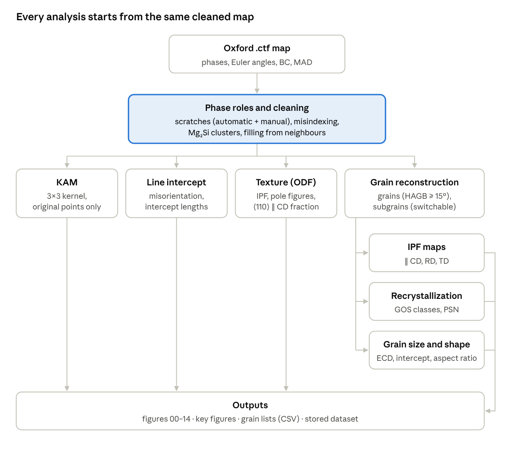

# EBSD Analysis 1.3 – User and Training Documentation

Version 1.3 · November 2026 · Institute of Metal Forming (IMF), TU Bergakademie Freiberg

A PDF version of this document is available: [EBSD-Analysis_1.3_Documentation.pdf](EBSD-Analysis_1.3_Documentation.pdf)

## 1 Introduction

EBSD Analysis 1.3 turns an Oxford/AZtec `.ctf` map of an aluminium alloy into a complete, reproducible set of figures, key figures and grain lists in a few minutes, without writing code. It was developed at the Institute of Metal Forming (IMF), TU Bergakademie Freiberg, for hot-deformed and forged AW-6082 and related Al–Mg–Si alloys, but works for any cubic matrix with one main phase.

All crystallographic calculations (orientations, misorientations, grain reconstruction, KAM, ODF) are done with **MTEX for Python**. The program adds the data cleaning, the classification rules, the figure layout and the bookkeeping around it.

**Who this guide is for**

- Students and new colleagues who want to analyse their own EBSD maps: read sections 2–7 and 13 first, then use sections 8–10 as a reference.
- Supervisors who need to know exactly what a reported number means: sections 6–10.
- Anyone maintaining the program: section 15.

**What the program produces from one map**

- Orientation maps (IPF ‖ CD, RD, TD), inverse pole figures and pole figures
- Kernel average misorientation (KAM) map
- Grain boundary misorientation distribution (LAGB/HAGB fractions)
- Phase distribution before and after cleaning
- Recrystallized fraction based on the grain orientation spread (GOS), with sensitivity and cross-checks
- Grain size, subgrain size and grain shape (aspect ratio, orientation of the major axis), with full grain lists as CSV
- Scratch detection and removal, automatic and manual
- A stored dataset per analysis, and comparison figures across several datasets

**New in version 1.3:** English user interface and outputs, manual marking and unmarking of scratches, and a switch for subgrain detection (for maps whose step size is too coarse to resolve subgrains).

> EBSD gives you numbers quickly. Whether they mean what you think depends on step size, preparation quality and the thresholds you choose. Section 13 lists the most common traps; please read it before you report results.

## 2 Installation and first start

The program is a portable Windows application: unpack, double-click, done. No installation and no administrator rights are needed.

**Requirements**

- Windows 10 or 11, 64 bit
- About 4 GB free memory for a typical map of about 2 million points (more for larger maps)
- An Oxford Instruments `.ctf` export on a square grid (hexagonal grids are not supported)

**Steps**

1. Copy the program folder (or unpack the ZIP file completely) to a local folder, e.g. `D:\Programs\EBSD-Auswertung`. Do not start it from inside a ZIP file.
2. Double-click `EBSD-Auswertung.exe`. The folder `_internal` must stay next to the `.exe`.
3. On the first start, Windows SmartScreen may warn because the program is not digitally signed: click *More info* → *Run anyway*.
4. Switch the language if needed: menu **Sprache / Language** → *English*, then confirm the restart (section 12).

The first analysis after each program start is noticeably slower because numerical routines are compiled once (numba). Subsequent analyses are faster.

**Where the program keeps its data**

| What | Location |
| --- | --- |
| Stored datasets (previews, key figures, grain lists) | `%LOCALAPPDATA%\EBSD-Auswertung\datensaetze` |
| Manual scratch marks per ctf file | `%LOCALAPPDATA%\EBSD-Auswertung\kratzer_markierungen.json` |
| Program output and error messages | `%LOCALAPPDATA%\EBSD-Auswertung\ausgabe.log` |
| Compiled routines (cache, can be deleted) | `%LOCALAPPDATA%\EBSD-Auswertung\numba-cache` |
| Window layout, parameters, language | Windows registry (Qt settings, "TU Bergakademie Freiberg IMF") |

Type `%LOCALAPPDATA%` into the Explorer address bar to get there. The stored datasets are per Windows user: colleagues on the same PC do not see each other's datasets.

## 3 Quick start: your first analysis

This tutorial takes you from a raw `.ctf` file to exported figures in about ten minutes. Use the default parameters for your first run; section 9 explains when to change them.

1. **Open the file.** *File → Open ctf file* (Ctrl+O). The left panel shows map size and step size, the phase table lists all phases from the file header, and the *Overview* tab shows the band contrast (BC) map.
2. **Check the phase roles.** In the phase table, exactly one phase must be *Matrix* (normally Aluminium). Real second phases such as α-AlFeMnSi are *Particle*. Phases that the indexing software assigned wrongly are *Misindexing*. The program suggests roles automatically; check them using the MAD and BC columns (section 6).
3. **Look at the overview.** Scratches appear as long dark straight lines. Click *Show automatic detection* to see what the program would remove (red). Correct it with the *Mark scratch* and *Unmark* tools if needed (section 7).
4. **Choose the functions.** For a first run leave all functions on. Switch *Detect subgrains* off if your step size is coarse compared with the expected subgrain size (section 8.8).
5. **Optional: select an area.** With the *Area* tool, drag a rectangle in the overview, or tick *analyse selected area only* and type the coordinates. Use this to exclude a damaged edge or to analyse the centre and the edge of a specimen separately.
6. **Enter a sample name** (group 5). It becomes the title of every figure, e.g. `AW-6082 (alloy 750-3)`.
7. **Start the analysis.** The progress bar and the *Log* tab show what is running. A 2-million-point map typically takes 1–3 minutes.
8. **Inspect the results.** The *Results* tab lists all figures with a preview. Always look at figure 00 (scratches) and figure 08 (phase distribution) first: they show whether the cleaning did what you expected.
9. **Read the key figures.** The *Key figures* tab contains every number together with the parameters used. Copy or save it with your figures.
10. **Export.** Tick the figures you need, choose formats (PNG for slides, PDF/SVG for papers, TIFF for some journals) and resolution (300 dpi is fine for print), choose a target folder and click *Export selected figures*.

The analysis is automatically stored as a dataset. To compare it with other specimens later, see section 11.

> Tip: Save your parameter set with *File → Save settings* when you start a measurement series, and load it for every map of the series. Results are only comparable if the parameters are identical.

## 4 User interface tour

The window has a settings panel on the left (what to analyse) and a results area on the right (what you get). Hover over any function or parameter for an explanation.

**Menus**

| Menu | Entries |
| --- | --- |
| File | Open ctf file; save/load settings (JSON); reset parameters to defaults; open folder of stored datasets; exit |
| Edit | Undo last scratch mark (Ctrl+Z); clear all scratch marks of this file |
| Sprache / Language | Deutsch, English (applied after a restart) |
| Help | Quick guide (F1); About |

**Left panel, tab *Analysis***

| Group | Purpose |
| --- | --- |
| 1 File | Open button, file name, number of points, step size, map size |
| 2 Phases and their role | Phase table with area fraction, median MAD, median BC and the role selector |
| 3 Functions | Cleaning (automatic scratch detection, Mg₂Si detection) and analyses (IPF, KAM, grain boundaries, texture, recrystallization, grain size, subgrain detection); count of manual scratch marks |
| 4 Area | Restrict the analysis to a rectangle (coordinates in µm) |
| 5 Sample name | Title shown on every figure |

The tab *Parameters* holds all numerical thresholds (section 9). Below both tabs: *Start analysis*, *Cancel* and the progress bar.

**Right panel**

| Tab | Content |
| --- | --- |
| Overview / area / scratches | Band contrast map of the whole file; tools *Area*, *Mark scratch*, *Unmark*; line width; Undo, Clear all; zoom and pan toolbar; *Show automatic detection*; *Show marks* |
| Results | Figure list (tick = export), preview with zoom, export settings (folder, formats, dpi, raster maps in PDF/SVG) |
| Datasets / Comparison | Stored datasets, comparison figures V1/V2 and comparison table |
| Key figures | All numbers and parameters of the current or selected dataset as text |
| Log | Progress messages, timings, warnings and error details |

The status bar at the bottom summarises the last action, e.g. recrystallized fraction and grain size after an analysis, or a warning if the subgrains are hardly resolved.

## 5 Specimen coordinate system and map conventions

The program assumes a longitudinal section through an upset (compressed) cylinder or forging, with the compression direction vertical in the map. Every direction-dependent result (IPF maps, pole figures, fibre fractions, intercept lengths in RD and CD, grain orientation) uses this frame.

| Axis | Name | Direction in the map |
| --- | --- | --- |
| x | RD – radial direction | horizontal, to the right |
| y | CD – compression direction | vertical, downwards in the map display |
| z | TD – section normal | perpendicular to the section plane |

- Map coordinates are given in µm from the top-left corner. Area coordinates (group 4) and scratch marks use the same system.
- The Euler angles of the ctf file are referred to this map frame with the standard MTEX correction for Oxford data. You do not need to rotate the data yourself, provided the specimen was mounted with the compression axis vertical in the SEM image.
- Angles of grain axes and scratches are measured from RD, counter-clockwise as seen in the map.
- Pole figures are shown twice: projected along CD (compression axis in the centre, the usual view for compression textures) and along TD (section plane, same orientation as the maps).

> If your specimen was mounted rotated by 90°, the labels RD and CD are swapped in all results. Check this before interpreting the ⟨110⟩ ∥ CD fibre fraction or the RD/CD intercept ratio.

## 6 Phase roles and data cleaning

Raw EBSD maps contain points that cannot be used directly: zero solutions (no pattern indexed), misindexed points and scratch artefacts. The program assigns every point to a clear category before any analysis, and figure 08 shows the map before and after this cleaning.

**6.1 Phase roles**

| Role | Meaning | What happens to the points |
| --- | --- | --- |
| Matrix | The main phase, exactly one (e.g. Aluminium) | All analyses (grains, KAM, texture, recrystallization) are done on it |
| Particle | A real second phase (e.g. α-AlFeMnSi, Al₆(Fe,Mn)) | Kept as particles; clusters smaller than *Particles, min. area* are treated as misindexing |
| Misindexing | A phase assigned by mistake | Discarded and filled in from the neighbours |

The suggestion when a file is opened: the most frequent phase is the matrix, phases with a median MAD ≤ 0.8° are particles, all others misindexing. Misindexing typically shows a **high MAD** (mean angular deviation, poor fit of the pattern) and a **low band contrast**. A phase that occurs as single scattered points all over the map is almost always misindexing; compact clusters of several µm are real particles. When in doubt, check with EDX.

**6.2 Zero solutions and Mg₂Si clusters**

In Al–Mg–Si alloys, Mg₂Si particles are often not indexed after metallographic preparation and appear as compact clusters of zero solutions with low band contrast. With *Mg₂Si detection* on, the program marks such clusters as Mg₂Si if they

- survive a 3×3 morphological opening (no thin lines or single points),
- are larger than *Zero-solution cluster, min. area*, and
- have a mean BC below *Zero-solution cluster, max. mean BC*.

This is an interpretation, not a measurement. Confirm it with EDX on a few clusters. With the function off, the clusters stay "non-indexed" and do not count as particles (e.g. in the PSN indicator).

**6.3 Filling of the remaining points**

All other non-indexed points (single zero solutions, misindexing, scratches) are filled in iteratively:

1. A point takes the phase that the majority of its 8 neighbours have, starting with points that have 7 indexed neighbours and going down to 1.
2. It takes the orientation of the nearest originally measured point of that phase.
3. Points that remain unassigned are counted as cluster.

The cleaned map is used for grain reconstruction, IPF maps, texture and grain size. **KAM and GOS are calculated only from originally indexed matrix points**, so filled points do not create artificial orientation gradients.

## 7 Scratches: automatic detection and manual editing

Polishing scratches appear in EBSD maps as long straight lines of zero solutions, misindexing and low band contrast. Left in the data, they split grains, create false boundaries and lower the indexing rate. The program removes them in two complementary ways: an automatic detection and a manual correction by the user.

**7.1 Automatic detection**

1. Candidate points are zero solutions, misindexed points and points whose band contrast is below *Scratches: relative BC threshold* × the local band contrast of their surroundings.
2. The program searches for straight lines through many candidate points (all directions).
3. Along each line, the density of candidates is evaluated in a sliding window (*Scratches: window length*). Only continuous sections longer than *Scratches: min. length* are accepted.
4. The width of each scratch is estimated, and all points within the scratch band are marked.

Marked points are not used as measurements and are filled in from the neighbours (section 6.3). Figure 00 shows each detected scratch with its direction, length and width. Very short scratches, curved scratches and scratches along grain boundaries are often missed; straight grain boundaries with many zero solutions can occasionally be marked by mistake.

**7.2 Manual marking and unmarking (new in 1.3)**

Use the toolbar of the *Overview* tab:

| Tool / button | What it does |
| --- | --- |
| Area | Default tool: drag a rectangle to select the analysis area |
| Mark scratch | Hold the left mouse button and draw a straight line along a scratch; all points within the set *Width* (µm) count as scratch |
| Unmark | Draw a line over a wrong marking; within its width nothing counts as scratch, neither automatic nor earlier manual marks |
| Width | Width of the line you draw, in µm (typically 2–4 step sizes) |
| Undo (Ctrl+Z) / Clear all | Remove the last line / all manual lines of this file |
| Magnifier, pan, home | Zoom into the map for precise drawing; deselect the magnifier before drawing again |
| Show automatic detection | Runs only the automatic scratch detection (whole map or selected area) and shows the result |
| Show marks | Shows or hides the coloured overlay |

Colours in the overview and in figure 00: **red** = detected automatically, **magenta** = marked manually, **light blue** = marking removed.

Lines are applied in the order you draw them, so a later line overrides an earlier one where they overlap. The final scratch mask is

```
scratch = (automatic AND NOT unmarked) OR marked
```

**Recommended workflow**

1. Open the file and click *Show automatic detection*.
2. Zoom in on every red line and check it against the band contrast. Remove false detections with *Unmark*.
3. Mark missed scratches with *Mark scratch*.
4. Start the analysis and check figure 00.

**Storage and reproducibility.** Manual marks are saved per ctf file as soon as you draw them and are restored when you open the file again. They are stored with each dataset, listed line by line in the key figures, and reused by *Recalculate*. They apply even when the automatic detection is switched off. Marks are given in map coordinates (µm), so they remain valid when you change the analysis area.

## 8 Analysis modules and methods

Each function in group 3 is a module that can be switched off to save time. The cleaned map (section 6) feeds all modules; grain reconstruction runs only if IPF maps, recrystallization or grain size are selected.



KAM and the line intercept use the measured points directly; IPF maps, recrystallization and grain size all depend on the grain reconstruction and therefore on the HAGB, LAGB and θc thresholds.

**8.1 Grain reconstruction**

Grains are reconstructed with MTEX `calcGrains` on the cleaned map: neighbouring matrix points belong to the same grain if their misorientation is below the threshold angle. The program reconstructs up to three levels:

| Level | Threshold | Used for |
| --- | --- | --- |
| Grains | HAGB (default 15°) | Grain size, GOS classification, HAGB lines |
| Subgrains | LAGB (default 2°) | Subgrain size, LAGB lines in the maps |
| GOS subgrains | θc (default 2°) | Subgrain-level recrystallization classes |

If LAGB and θc are equal, the subgrain reconstruction is done only once. With *Detect subgrains* off, only the grain level is calculated (section 8.8).

**8.2 IPF maps (figures 01–03)**

Each matrix point is coloured by the crystal direction parallel to CD, RD or TD (TSL colour key, shown in the figure). Particles and clusters are drawn in fixed colours; HAGB are black lines, LAGB grey lines.

**8.3 Texture (figures 04, 05)**

An orientation density function (ODF) is estimated from all matrix points of the cleaned map with MTEX `calcDensity` and a kernel of the set half-width (default 5° HWHM). Inverse pole figures for CD, RD and TD and the {100}, {110}, {111} pole figures are given in multiples of random density (MRD). The key figures also give the area fraction with ⟨110⟩ within 15° of CD, the typical compression fibre of fcc metals; a random texture gives about 20 %.

**8.4 Kernel average misorientation (figure 06)**

KAM is the mean misorientation between a point and its 8 nearest neighbours (3×3 kernel); neighbour pairs above the *KAM threshold* (default 5°) are ignored so that grain boundaries do not count. Only originally indexed matrix points outside scratches are used. KAM is a measure of local lattice curvature and hence of geometrically necessary dislocations, but it scales with the step size.

**8.5 Grain boundary misorientation (figure 07)**

The misorientation distribution is measured with a line-intercept method: every row (RD) and column (CD) of the map is followed, and the misorientation is calculated between consecutive matrix points. Gaps of up to *Line intercept: max. gap* non-indexed points are bridged. Only intercepts ≥ LAGB count as boundaries. Results are given as fractions of boundary length (LAGB 2–15°, HAGB ≥ 15°, and the classes 2–5°, 5–15°, ≥ 15°), compared with the Mackenzie distribution of randomly oriented cubic grains. The same pass gives the mean linear intercept lengths used in section 8.7.

**8.6 Recrystallization (figures 09, 10)**

The classification follows the logic of Oxford Channel 5 and uses the grain orientation spread (GOS), the mean misorientation of all points of a grain from the grain's mean orientation:

```
GOS = (1/N) · Σ ω(gᵢ, ḡ)      i = 1 … N points of the grain,
                              ω = misorientation angle, ḡ = mean orientation
```

| Class | Rule (with subgrain detection) |
| --- | --- |
| Recrystallized | Grain (HAGB) with GOS ≤ θc |
| Substructured | In a non-recrystallized grain: subgrain (boundaries ≥ θc) with GOS ≤ θc |
| Deformed | In a non-recrystallized grain: subgrain with GOS > θc |
| Not classifiable | Fewer than *min. points per (sub)grain* indexed points |

The fractions are area fractions of the matrix. For comparison, the key figures also give the classic grain-level split (a grain is substructured if none of its subgrains exceeds θc, otherwise deformed).

Figure 10 adds (a) the area-weighted GOS distribution, (b) the sensitivity of the recrystallized fraction to θc from 0.5 to 5°, (c) a cross-check at subgrain level (low-GOS subgrains with a minimum HAGB share of their perimeter, a proxy for the CDRX transition), (d) the size of the recrystallized grains, (e) the recrystallized fraction versus distance to particles larger than *PSN: particles from* (an indicator of particle-stimulated nucleation), and (f) fibre fraction and mean KAM per class.

**8.7 Grain size and grain shape (figures 11–14)**

For each grain and subgrain the program calculates the area A, the equivalent circle diameter and the ellipse with the same second area moments (major and minor axis, angle of the major axis to RD):

```
ECD = 2 · √(A / π)          AR = major axis / minor axis
```

Edge grains (touching the map border) and grains with fewer than *Grain size: min. points per (sub)grain* indexed points are excluded from the statistics but kept in the grain lists. Reported values: number-weighted ECD (mean, standard deviation, median, d10, d90), area-weighted ECD, mean linear intercept in RD and CD, aspect ratio (mean, median, area-weighted, fraction < 2), and for grains with AR ≥ 1.5 the area-weighted mean direction of the major axis with an alignment factor R (0 = random, 1 = all parallel). The grain size number G according to ASTM E112 is derived from the HAGB mean linear intercept l (in mm):

```
G = −6.643856 · log₁₀(l) − 3.288      l = mean linear intercept in mm
```

**8.8 Subgrain detection switch (new in 1.3)**

Subgrains can only be reconstructed if each subgrain contains enough measurement points. As a rule of thumb, a subgrain should be at least about 5 step sizes across. After each analysis with subgrains, the program checks the median subgrain ECD; if it is below 5 step sizes, a note appears in the status bar, the log and the key figures.

Switch *Detect subgrains* off for coarse maps (e.g. overview maps of large forgings). Then:

- no subgrain reconstruction, no LAGB lines in the maps, no figure 12, no subgrain list;
- recrystallization is classified at grain level only: **recrystallized** (GOS ≤ θc) or **non-recrystallized** (GOS > θc); substructured and deformed cannot be separated;
- the subgrain cross-check in figure 10 (c) is omitted;
- the misorientation distribution (figure 07) is unchanged, because it does not depend on reconstructed subgrains;
- the dataset comparison marks the dataset as "without subgrains" and shows “–” for subgrain values.

Results with and without subgrain detection are not directly comparable for the substructured/deformed split; the recrystallized fraction is the same.

## 9 Parameter reference

All parameters are on the *Parameters* tab, saved on exit, and written to the key figures of every analysis. *File → Reset parameters to defaults* restores the values below.

| Parameter | Default | Range | Effect |
| --- | --- | --- | --- |
| LAGB, lower limit | 2.0° | 0.5–10° | Smallest misorientation counted as a boundary; subgrain threshold |
| HAGB, threshold | 15° | 5–30° | High-angle boundaries; grain reconstruction |
| KAM threshold | 5.0° | 1–15° | Neighbour pairs above this angle are ignored in the KAM |
| KAM colour scale up to | 2.0° | 0.5–10° | Upper limit of the KAM map colour scale (display only) |
| Line intercept: max. gap | 5 points | 0–20 | Non-indexed points bridged in the line intercept |
| Zero-solution cluster, min. area | 1.4 µm² | 0.1–50 | Smaller zero-solution clusters are filled in, larger ones become Mg₂Si |
| Zero-solution cluster, max. mean BC | 100 | 10–255 | Clusters with higher mean band contrast are filled in |
| Particles, min. area | 0.28 µm² | 0–10 | Smaller particle clusters are treated as misindexing |
| ODF half-width | 5.0° | 2–20° | Kernel half-width (HWHM) for texture; 5° corresponds to 10° FWHM |
| θc (GOS threshold, subgrain boundary) | 2.0° | 0.5–10° | Recrystallized: GOS ≤ θc; also the subgrain threshold for the classification |
| min. points per (sub)grain | 10 | 3–200 | Smaller grains are "not classifiable" in the recrystallization analysis |
| Grain size: min. points per (sub)grain | 10 | 1–500 | Smaller (sub)grains are excluded from the size statistics |
| PSN: particles from | 1.0 µm | 0.2–10 | Minimum particle ECD for the distance analysis in figure 10 (e) |
| Scratches: min. length | 40 µm | 5–500 | Minimum continuous length of an automatically detected scratch |
| Scratches: relative BC threshold | 0.75 | 0.3–0.95 | A point is a candidate if its BC < value × local BC |
| Scratches: window length | 9.0 µm | 2–50 | Window for the sliding candidate density along a line |

**When to change what**

- Keep LAGB, HAGB and θc at 2° / 15° / 2° unless you have a reason; they are the common literature convention for Al alloys. LAGB below about 1.5° is usually below the angular resolution of conventional EBSD and picks up noise.
- The area thresholds (Mg₂Si, particles) are in µm² and therefore independent of step size, but at a coarse step size a cluster of 1.4 µm² may be only 1–2 points.
- If many short scratches are missed, lower *Scratches: min. length*; if grain boundaries are marked as scratches, raise it or lower the relative BC threshold. Often manual marking (section 7.2) is the faster fix.

## 10 Figures and output files

The file names below are those of the English version; the German version uses German names (e.g. `09_Rekristallisation_Karte`). Figures are only produced if their module is switched on.

| No. | Figure (English file name) | Module | Check it for |
| --- | --- | --- | --- |
| 00 | Scratch detection (`00_Scratch_detection`) | Scratches (automatic or manual) | Are all scratches caught, nothing else? |
| 01–03 | IPF map ‖ CD / RD / TD (`01_IPF_map_CD` …) | IPF maps | Grain structure, boundaries, orientation |
| 04 | Inverse pole figures | Texture | Fibre texture, max. MRD |
| 05 | Pole figures {100}, {110}, {111} | Texture | Texture components in two projections |
| 06 | KAM map | KAM | Deformation localisation, shear bands |
| 07 | Grain boundary misorientation histogram | Grain boundaries | LAGB/HAGB fractions vs. Mackenzie |
| 08 | Phase distribution | always | Cleaning: raw vs. cleaned phase fractions |
| 09 | Recrystallization map | Recrystallization | Where the recrystallized grains are |
| 10 | Recrystallization statistics (six panels) | Recrystallization | Sensitivity to θc, PSN indicator |
| 11 | Grain size map | Grain size | ECD per grain, excluded grains in grey |
| 12 | Subgrain size map | Grain size + subgrains | ECD per subgrain |
| 13 | Grain aspect ratio map | Grain size | Elongated vs. equiaxed grains |
| 14 | Grain size and shape statistics (six panels) | Grain size | Distributions, key figure table |

All map figures share one layout: map with scale bar on the left, explanatory text, colour bar, histogram, legend and the specimen axes on the right; the subtitle states map size, step size, removed scratches and whether subgrain detection was off.

**Text and table files (always written with an export)**

| File (English / German) | Content |
| --- | --- |
| `Results_and_parameters.txt` / `Kennwerte_und_Parameter.txt` | All key figures by module, including file, area, phase roles, scratch list, manual marks and the complete parameter set |
| `Grain_list_grains.csv` / `Kornliste_Koerner.csv` | One row per grain: ID, centroid, points, area, ECD, axes, aspect ratio, angle, edge flag, in-statistics flag, mean Euler angles, GOS and class |
| `Grain_list_subgrains.csv` / `Kornliste_Subkoerner.csv` | One row per subgrain, with the ID of the parent grain (only with subgrain detection) |

CSV format: English version comma-separated with decimal point; German version semicolon-separated with decimal comma (opens directly in German Excel). Files are UTF-8 with BOM so that µ and ° display correctly.

**Formats.** PNG for slides and reports, PDF or SVG for publications (text and diagrams stay vector graphics; maps are embedded as raster images unless you untick *Maps in PDF/SVG as raster image*, which gives very large files), TIFF (LZW) where a journal asks for it.

## 11 Datasets and comparison

Every analysis is stored automatically as a dataset, so you can review, export and compare results later without recalculating. The same ctf file with the same area replaces its earlier dataset; a different area creates a new one.

**What a dataset contains:** preview images of all figures, the key figures text, the grain lists, the settings, phase roles, area, manual scratch marks and a set of numbers for the comparison. It does not contain the ctf file itself; the path to it is stored.

**Tab *Datasets / Comparison***

| Button | Action |
| --- | --- |
| Show results (or double-click) | Shows previews and key figures under *Results* / *Key figures*, without recalculation |
| Recalculate | Loads the ctf file and analyses it again with the stored settings, roles, area and scratch marks |
| Rename | Changes the label used in comparison figures (default: alloy, temperature / strain rate, position, derived from the file name) |
| Remove | Deletes the stored dataset (the ctf file and exported files stay) |
| up / down | Order of the datasets in the comparison figures |
| all / none | Ticks or unticks all datasets for the comparison |

Ticked datasets appear in two comparison figures and a table:

- **V1 Comparison of key figures:** subgrain size (median ECD), HAGB fraction, recrystallized fraction in total and within 0–1 µm of particles, ⟨110⟩ ∥ CD fibre fraction.
- **V2 Misorientation distribution:** the distributions of all datasets overlaid (2° classes).
- **Table:** about 27 key figures per dataset, including step size, subgrain detection on/off and the number of manual scratch marks.

*Export comparison* writes V1 and V2 in the formats and resolution selected under *Results*, plus `Comparison_key_figures.csv`. *Copy table* puts the same table on the clipboard for Excel.

**Exporting a stored dataset.** Previews are stored at screen resolution. For publication-quality figures, choose *Recalculate and export*; this takes as long as a new analysis. *Copy previews and key figures* is instant but gives preview resolution only.

Datasets stored with version 1.2 remain usable; they count as "with subgrain detection" and "no manual marks".

## 12 Language settings

The program runs in German or English. Choose the language in the menu **Sprache / Language**; the program asks whether to restart now or later, and the choice is remembered.

| Affected | German | English |
| --- | --- | --- |
| User interface, help, messages | German | English |
| Figure titles, labels, legends | German | English |
| Decimal separator in figures and key figures | comma (3,14) | point (3.14) |
| Output file names | e.g. `Kennwerte_und_Parameter.txt` | e.g. `Results_and_parameters.txt` |
| CSV files | semicolon, decimal comma | comma, decimal point |
| Number input fields | decimal comma | decimal point |

Figures and key figures are created in the language that is active at the time of the analysis or export. A dataset analysed in German keeps its German key figures text when viewed in the English version; its figure titles in the results list are shown in the current language. Recalculate the dataset to get all outputs in the other language.

From the command line, `--lang en` or `--lang de` overrides the stored choice for that run.

## 13 Good practice and interpretation pitfalls

Most wrong EBSD conclusions do not come from software errors but from comparing results that are not comparable. Check these points before you report a number.

**Before the measurement**

- Choose the step size for the smallest feature you want to quantify. Subgrains of 3–5 µm need a step size of about 0.5 µm or finer; a grain size of 50 µm can be measured at 2–5 µm.
- Measure all specimens of a series with the same step size, magnification and settings. KAM, LAGB fraction and subgrain size all change with step size.
- A map should contain enough grains: aim for at least a few hundred grains inside the map (not touching the edge) for a reliable grain size distribution.

**During the analysis**

- Always inspect figure 00 (scratches) and figure 08 (cleaning). If more than a few percent of the area had to be filled in, say so in your report.
- Use the same parameter file for the whole series (*File → Save/Load settings*).
- Use an area selection to exclude preparation damage at specimen edges, but select comparable areas (e.g. same position relative to the forging axis) for all specimens.

**When interpreting**

- **Recrystallized fraction:** post-mortem EBSD cannot distinguish dynamic from metadynamic or static recrystallization. The fraction is a DRX fraction only for specimens quenched directly after deformation. Always look at the sensitivity curve (figure 10 b): if the fraction changes strongly between θc = 1° and 3°, report it with that range.
- **Grain size:** state which measure you report (number-weighted ECD, area-weighted ECD or mean linear intercept); they can differ by a factor of 2. Elongated grains have very different intercepts in RD and CD.
- **KAM:** a relative measure. Compare KAM values only between maps of identical step size and KAM threshold.
- **Subgrains:** if the program warns that the median subgrain ECD is below 5 step sizes, do not report subgrain sizes from that map; switch subgrain detection off instead.
- **Mg₂Si clusters:** an interpretation of zero solutions, not an identification. Verify with EDX before discussing Mg₂Si fractions.
- **Texture:** one map of a few hundred grains gives a rough texture estimate only. Maximum MRD values from small maps are strongly affected by individual large grains.

**What to write in a report or thesis**

State at least: program and version (EBSD Analysis 1.3, MTEX for Python), step size, map area, cleaning steps (scratches automatic/manual, Mg₂Si detection, filled area fraction), thresholds (LAGB, HAGB, θc, minimum grain size), and which grain size measure you used. All of this is in the key figures file; attach it to your raw data.

## 14 Troubleshooting and FAQ

| Problem | Cause and solution |
| --- | --- |
| Program does not start, nothing happens | Started from inside a ZIP, or `_internal` is missing next to the `.exe`. Unpack completely. Check `%LOCALAPPDATA%\EBSD-Auswertung\ausgabe.log`. |
| "The map is not a square grid" | Hexagonal grid export. Re-export from AZtec on a square grid. |
| "Exactly one phase must be set as matrix" | Check the role column in the phase table. |
| "The selected area is too small" | An area needs at least 20 × 20 points. |
| First analysis takes much longer than later ones | Normal: routines are compiled on the first run after each start. |
| Out of memory / very slow | Map too large for the PC. Analyse areas, switch off unneeded modules (texture and subgrains cost most), close other programs. |
| Drawing in the overview does nothing | The *Area* tool is active, or the magnifier/pan of the toolbar is still on. Select *Mark scratch* or *Unmark* (this also ends the magnifier). |
| Manual marks are gone after reopening | Marks are stored per file path; a renamed or moved ctf file starts without marks. Recalculating a stored dataset restores its marks. |
| Grain boundaries are marked as scratches | Use *Unmark* on them, or raise *Scratches: min. length*. |
| Recrystallized fraction near 0 % or 100 % in an unexpected way | Check θc, the GOS histogram (figure 10 a) and whether filled-in areas are large. Very coarse step size inflates the fraction (grains with few points look perfect). |
| Note "subgrains hardly resolved" | Median subgrain ECD < 5 step sizes. Switch *Detect subgrains* off or measure with a finer step. |
| Language did not change | The language is applied after a restart. Choose *Restart now* or restart manually. |
| CSV opens in one column in Excel | CSV format follows the program language. In English Excel use the English program version or *Data → From Text/CSV* with semicolon as separator. |
| Recalculate: "ctf file not found" | The ctf file was moved. Open it from its new location and analyse again; the stored previews remain available. |
| An error dialog appears | Details are in the *Log* tab. Copy the log text when you report the problem. |

**FAQ**

- *Can I analyse magnesium or steel?* The program assumes one cubic matrix phase (classification thresholds, ⟨110⟩ fibre, Mackenzie curve). Other cubic alloys work; hexagonal matrices (Mg, Ti-α) are not supported in the present form.
- *Does the program change my ctf file?* No. It only reads it.
- *Are manual scratch marks shared with colleagues?* They are stored per Windows user. Colleagues get them through the dataset only if they use the same account; otherwise the marks are listed in the key figures file and can be redrawn.

## 15 For developers: code structure, build and self-test

The program is written in Python (PySide6 for the interface, MTEX for Python for crystallography, NumPy/SciPy/matplotlib). The source code is in the folder `EBSD-Auswertung_1.3_Quellcode\EBSD-Auswertung_Quellcode`.

| File | Responsibility |
| --- | --- |
| `ebsd_gui.py` | Main window, overview canvas with drawing tools, background tasks, export, language restart, command-line modes |
| `ebsd_core.py` | Loading ctf files (`EBSDProject`), scratch detection, cleaning, all analyses, all figures, key figures, grain lists (`analyze` → `Result`) |
| `ebsd_datasets.py` | Dataset store, comparison table, comparison figures V1/V2 |
| `ebsd_settings.py` | `Settings` dataclass, parameter list, figure list (German and English titles and file names), version |
| `ebsd_i18n.py` | Language switch `L(german, english)`, number formatting, CSV helpers |
| `ebsd_marks.py` | Manual scratch marks: rasterising lines into masks, combining with the automatic mask |
| `EBSD-Auswertung.spec` | PyInstaller build definition |
| `build_windows.bat` / `uebernehmen.bat` | Build the program / move it into the program folder and archive the previous version |

**Conventions**

- Every user-visible text is written as `L("German", "English")` (in `ebsd_core.py` imported as `tx`, because `L` is the phase-label array there). Add both languages for every new text.
- Internal identifiers stay German and language-independent: phase roles (`Matrix`, `Partikel`, `Fehlindizierung`), metric keys in stored datasets, the internal key figures file name in the store.
- New settings are added to `Settings` with a default that reproduces the previous behaviour, so old datasets and settings files stay valid.
- `analyze` only computes; figures are built lazily by functions in `builders`, so previews and exports in the current language are cheap.

**Building the Windows program**

1. Python 3.13 (64 bit) with the packages in `requirements.txt` (exact versions).
2. Run `build_windows.bat` in the source folder. The program is built into `%LOCALAPPDATA%\EBSD-Build\dist\EBSD-Auswertung`.
3. Close the running program and run `uebernehmen.bat`. It moves the previous version (program and source folder) into `alte Versionen\V1.2` and copies the new build into the program folder.

**Self-test without user interface**

```
EBSD-Auswertung.exe --selftest "C:\path\file.ctf" "C:\path\output" [--crop x0 y0 x1 y1] [--lang en] [--nosub]
```

It analyses the file with default settings, exports all figures as PNG (and the first two as PDF, SVG, TIFF) and writes `selbsttest.log` ending in `SELBSTTEST OK` or `SELBSTTEST FEHLER`. Further options for testing: `--autotest file.ctf output` (runs the full interface automatically) and `--screenshot image.png --ctf file.ctf [--run] [--marks]` (renders the window to an image).

**Licence.** Because MTEX for Python is licensed under GPL-2.0, the program is distributed under GPL-2.0 with its source code.

## 16 Glossary and further reading

| Term | Meaning |
| --- | --- |
| BC – band contrast | Quality of the Kikuchi pattern; low at boundaries, scratches, deformed regions and poorly prepared surfaces |
| MAD – mean angular deviation | Fit between measured and simulated pattern bands; high values indicate unreliable indexing |
| Zero solution | Point where no pattern could be indexed |
| Misindexing | Point assigned to a wrong phase or orientation |
| Step size | Distance between measurement points (µm); sets the resolution limit |
| Misorientation | Smallest rotation angle between two crystal orientations, taking crystal symmetry into account |
| LAGB / HAGB | Low-angle (2–15°) / high-angle (≥ 15°) grain boundary |
| Grain / subgrain | Region enclosed by HAGB / by boundaries ≥ LAGB |
| ECD | Equivalent circle diameter: diameter of a circle with the same area |
| Mean linear intercept | Mean distance between boundaries along test lines |
| Aspect ratio | Ratio of major to minor axis of the equivalent ellipse |
| KAM | Kernel average misorientation: mean misorientation to the nearest neighbours |
| GOS | Grain orientation spread: mean deviation of a grain's points from its mean orientation |
| θc | GOS threshold separating recrystallized from non-recrystallized material |
| IPF | Inverse pole figure: which crystal direction is parallel to a specimen direction |
| ODF / MRD | Orientation distribution function / multiples of random density |
| Fibre texture ⟨110⟩ ∥ CD | Typical compression texture of fcc metals |
| DRX / CDRX / PSN | Dynamic recrystallization / continuous dynamic recrystallization / particle-stimulated nucleation |
| Mackenzie distribution | Misorientation distribution of randomly oriented cubic crystals |
| RD / CD / TD | Radial direction / compression direction / section normal (section 5) |

**Further reading**

- MTEX documentation (MATLAB and Python): https://mtex-toolbox.github.io – orientations, grains, KAM, ODF estimation.
- F. J. Humphreys, M. Hatherly: *Recrystallization and Related Annealing Phenomena*, Elsevier – the standard text on recovery, recrystallization and PSN.
- A. J. Schwartz, M. Kumar, B. L. Adams, D. P. Field (eds.): *Electron Backscatter Diffraction in Materials Science*, Springer – EBSD fundamentals, data quality and analysis.
- S. I. Wright, M. M. Nowell, D. P. Field: "A review of strain analysis using electron backscatter diffraction", *Microscopy and Microanalysis* 17 (2011) – KAM, GOS and their step-size dependence.
- ASTM E112: *Standard Test Methods for Determining Average Grain Size* – grain size number G and intercept methods.
- J. K. Mackenzie: "Second paper on statistics associated with the random disorientation of cubes", *Biometrika* 45 (1958) – the reference misorientation distribution.
